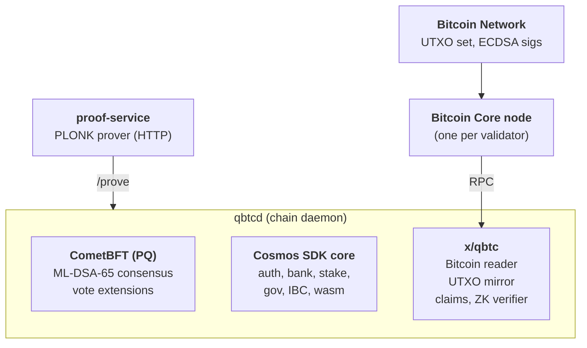

QBTC is a Cosmos SDK application chain that runs on a forked CometBFT consensus engine using post-quantum signatures. It maintains a mirror of the Bitcoin UTXO set inside its own state and accepts zero-knowledge proofs of BTC ownership as claims against that mirror.

For deeper specifications, see the [Protocol Specification](/research/protocol-spec).

## High-level picture

## The main components

### 1. The chain daemon (`qbtcd`)

`qbtcd` is a Cosmos SDK v0.55 application binary. It registers the standard SDK modules (`auth`, `bank`, `staking`, `slashing`, `distribution`, `gov`, `upgrade`, `evidence`, `feegrant`, `authz`, `consensus`, `params`, `epochs`, `group`, IBC v10, ICS-27 interchain accounts, IBC transfer, CosmWasm, and `tokenfactory`) and adds one custom module: **`x/qbtc`**.

Notable chain parameters:

* **Bech32 prefixes:** `qbtc` (accounts), `qbtcvaloper` (validators), `qbtcvalcons` (consensus).
* **Default bond denom:** `qbtc`.
* **Coin type:** 118 (standard Cosmos).

### 2. The post-quantum consensus engine (CometBFT, forked)

QBTC depends on a fork of CometBFT that introduces a new `crypto/mldsa` package and routes consensus signing through ML-DSA (CRYSTALS-Dilithium / FIPS 204) instead of Ed25519.

Every validator's consensus key is an ML-DSA key, every vote is signed with ML-DSA, every block-commit signature is ML-DSA. No wrapper or sidecar layer. The fork is maintained at `github.com/btcq-org/cometbft`.

QBTC uses the ML-DSA-65 parameter set. ML-DSA-65 signatures are larger than Ed25519 (3309 bytes vs. 64 bytes per FIPS 204), which affects block size and bandwidth. The trade-off is intentional: the consensus path has no ECDSA or Ed25519 dependency. Accounts use ML-DSA-65 as well. The chain rejects all other account key types, including secp256k1, ed25519 and multisig.

See [Quantum Resistance (ML-DSA)](/build/quantum-resistance) for details.

### 3. The custom module (`x/qbtc`)

The single custom module handles everything QBTC-specific:

| Subfolder | Responsibility |
|---|---|
| `keeper/` | State management and message handlers for claims and UTXO mirror |
| `types/` | Protobuf-generated types and message validation |
| `module/` | Cosmos module wiring and genesis state loader |
| `zk/` | PLONK circuits and the on-chain verifier for claim proofs |
| `btcreader/` | The Bitcoin reader: fetches and checks blocks from the validator's own Bitcoin node and caches them for vote extensions |

The module's surface area is intentionally small. Standard SDK modules handle staking, governance, fees, and IBC. The custom module is the part that has to be QBTC-specific.

### 4. Bitcoin block ingestion (vote extensions)

Each validator's `qbtcd` runs a Bitcoin reader (`x/qbtc/btcreader`). There is no separate process. The reader fetches each new block from the validator's own Bitcoin Core node after 6 confirmations, checks its hash and merkle root, and caches it.

1. In each consensus vote, the validator lists the Bitcoin blocks it has cached (a CometBFT **vote extension**, signed with its ML-DSA-65 consensus key).
2. The next proposer counts the votes. It includes a Bitcoin block when validators with more than **2/3 of voting power** voted for the same block.
3. The proposer injects the block into the QBTC block as a special transaction.
4. Every validator checks the injected block again. The chain recomputes every transaction ID and the merkle root, checks that the header links to the last processed block, and checks the proof of work at Bitcoin's difficulty.

QBTC's view of Bitcoin is itself produced by a Byzantine-fault-tolerant consensus, not by a single oracle or trusted relayer. Validators choose which Bitcoin branch to follow, but they cannot invent transactions or outputs.

### 5. The proof service (`proof-service`)

The `proof-service` is a standalone HTTP service. The wallet signs a digest with the Bitcoin key and sends the signature to a proving service. The service builds the zero-knowledge proof and broadcasts the claim. The Bitcoin public key never goes on chain. The private key stays in the wallet.

A CLI version (`zkprover`) is available for users who want to generate proofs locally.

## Binaries shipped

| Binary | Purpose |
|---|---|
| `qbtcd` | Chain daemon (validators and full nodes run this) |
| `proof-service` | Remote PLONK prover (optional infrastructure, anyone can host) |
| `zkprover` | CLI for local proof generation |
| `utxo-indexer` | Builds the bootstrap UTXO seed from a Bitcoin node |

## The data flow for a single claim

1. User decides to claim their BTC at address `1A1z...` to a QBTC address `qbtc1...`.
2. The user's wallet signs a digest with the Bitcoin key. The digest binds the destination QBTC address.
3. The wallet sends the signature to a proving service. The service builds the ZK proof.
4. The service submits the proof to QBTC as a `MsgClaimWithProof` transaction. A single transaction can claim up to 50 UTXOs at once.
5. A QBTC validator picks up the transaction, runs the on-chain PLONK verifier, checks each referenced UTXO has an outstanding claim, and checks the destination address is valid.
6. The transaction lands in a block. The claim is released to the destination QBTC address and the corresponding entry is marked as exhausted, preventing double-claims.

The user's BTC is never moved. The user's BTC public key never goes on chain.

## How Bitcoin's state stays mirrored

1. Bitcoin produces a block.
2. After 6 confirmations, each validator's Bitcoin reader fetches the block from its own Bitcoin node and checks it.
3. Each validator attests the block in its consensus vote, signed with its ML-DSA-65 consensus key.
4. When validators with more than 2/3 of voting power attest the same block, the next proposer includes it.
5. The accepted block is injected as a special transaction in the next QBTC block. The transaction updates the UTXO mirror: new outputs become claims, spent outputs are reconciled.
6. Coinbase outputs add new claim entries. Bitcoin miners receive a corresponding QBTC claim as well.

## Read next

* [Quantum Resistance (ML-DSA)](/build/quantum-resistance)
* [Consensus & Validators](/build/consensus)
* [Claim Mechanism](/build/claim-mechanism)
* [Protocol Specification](/research/protocol-spec)
