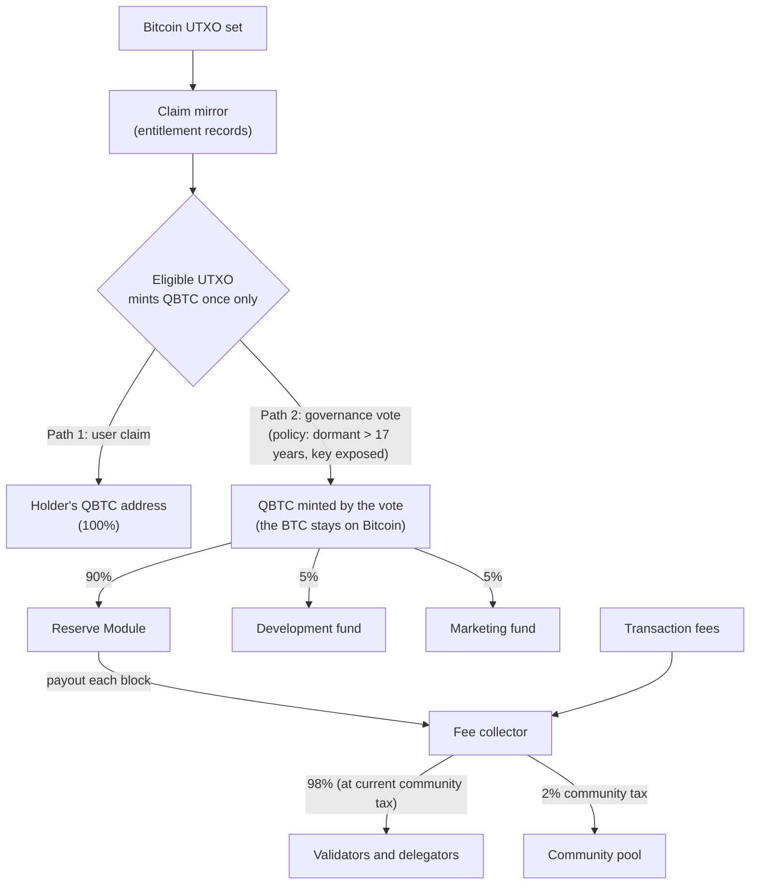

import { tokenomicsData } from "/snippets/tokenomics-data.jsx";
import { SegmentedBar, ReserveCurve } from "/snippets/tokenomics-charts.jsx";

QBTC's economic design rests on three invariants. There is no sale, no premine, no investor allocation, no vesting and no inflation.

1. **Cap matches Bitcoin.** Total supply is hard-capped at 21,000,000 QBTC.
2. **One mint at genesis, then claims only.** Genesis mints 50 QBTC, committed to securing the chain during the genesis period. In exchange, the 50 BTC coinbase output of Bitcoin's genesis block (block 0) can never be claimed, because Bitcoin never added it to its UTXO set. So the total stays within 21 million. After genesis, tokens come into existence only when a Bitcoin UTXO is claimed, by either a user or by governance.
3. **The claim mirror is a ledger of entitlements**, not a pool of tokens. Tokens are minted only when an entitlement is exercised.

## How QBTC moves



Each eligible Bitcoin UTXO can mint QBTC one time, by one of the two paths. A user claim sends the full amount to the holder ([Claim Mechanism](/build/claim-mechanism)). A governance reclamation splits the amount 90 / 5 / 5. The Reserve has one inflow: governance reclamation. Transaction fees do not go to the Reserve. Fees and Reserve payouts meet in the fee collector, which pays validators, delegators and the community pool.

## The claim mirror

The chain state contains a continuous mirror of Bitcoin's UTXO set. For each live Bitcoin UTXO, the mirror stores an entitlement record:

```
(BTC_UTXO_id, Hash160(address), BTC_amount, claimed_flag)
```

The mirror is a record of who is *allowed* to mint QBTC against which Bitcoin UTXOs. Tokens are minted only when an entitlement is exercised.

The mirror updates with every new Bitcoin block:

* New BTC outputs (including coinbase rewards) add new entitlement entries.
* Spent BTC outputs are reconciled. The `claimed_flag` propagates to descendant UTXOs: any output of a transaction whose inputs include claimed UTXOs inherits the claimed status, in proportion to the inherited value. A child of a fully-claimed parent cannot be claimed.

Propagation makes governance reclamation permanent: once reclaimed, value cannot re-enter the claimable pool by being spent through Bitcoin.

Eligibility is live with no snapshot date. Whoever controls an eligible unspent output at claim time can claim it. A new output needs 144 Bitcoin confirmations (about one day) before it can claim.

## Two minting paths

### Path 1: User claim

A holder submits `MsgClaimWithProof` with a ZK proof of ownership over a BTC address, a destination QBTC address, and a list of UTXOs to claim (up to 50).

If the proof verifies and the referenced UTXOs are unclaimed, the chain:

1. Marks each referenced UTXO as claimed.
2. **Mints** the sum of the claimed UTXOs' BTC amounts as QBTC into the destination QBTC address.

Before this step, the entitlement is a record in the mirror. After this step, the QBTC tokens exist as native chain state.

### Path 2: Governance reclamation of dormant exposed-key UTXOs

Bitcoin holds a large pool of value in UTXOs that satisfy both:

* Not moved for more than 17 years.
* Public key is on-chain (P2PK outputs or reused-address outputs).

The 17-year rule is a governance commitment. Each proposal writes the cutoff as a Bitcoin block height, lists the outputs it reclaims, and needs a passing vote. Later votes can move the cutoff forward as more outputs pass 17 years.

These UTXOs are structurally indefensible against a quantum-capable attacker: a CRQC operator can derive the private key from the exposed public key faster than the owner (if any) can move the coin.

On Bitcoin Legacy, this value will be captured by the first viable quantum attacker. It is economically lost.

On QBTC, governance reclaims it productively. Through standard `x/gov` proposals (the voting period is a governance parameter):

1. A proposal identifies one or more UTXOs meeting the dormant exposed-key criteria.
2. Validators vote.
3. If the proposal passes, each referenced UTXO is marked as claimed (same `claimed_flag` as a user claim), and **QBTC equal to the reclaimed BTC value is minted on the QBTC chain**.
4. The reclaimed UTXOs and any descendants are permanently ineligible for user claim.

The reclaim does not protect the coins on Bitcoin. It sends the matching QBTC to the Reserve and the two funds, which fund the network.

### How reclaimed QBTC is distributed

Each successful reclamation proposal mints QBTC and splits it 90 / 5 / 5:

| Destination | Share | Purpose |
|---|---|---|
| **Reserve Module** | 90% | Funds validator emission (the main use of QBTC reclaimed by governance). |
| **Development fund** | 5% | Funds continued protocol development. |
| **Marketing fund** | 5% | Funds adoption and education. |

<SegmentedBar label="Split of each governance reclamation" parts={tokenomicsData.split} note={tokenomicsData.splitNote} />

The 5% shares are fixed in code. The two fund addresses are governance parameters. If a fund address is not set, its 5% goes to the Reserve.

The two funds are the only project share of QBTC.

Each governance reclamation is a public, recorded event: the proposal identifies the UTXOs, validators vote, the chain executes the split.

## The Reserve Module

The Reserve Module is a module account on the chain. It holds QBTC that has been minted via governance reclamation (90% share above) but not yet paid out to validators.

**One inflow:**

* Governance reclamation of dormant exposed-key UTXOs.

**One outflow:**

* Validator emission, per block. Per `x/qbtc/keeper/network_manager.go:24–45`, called from the module's EndBlock:

```
release_per_block = reserve_balance / (EmissionCurve × BlocksPerYear)
```

`EmissionCurve` and `BlocksPerYear` are on-chain parameters. A governance vote can change them. Mainnet sets their values at genesis. Payouts fall as the Reserve shrinks, and new reclaims top it up.

The released amount is transferred from the Reserve Module to the standard Cosmos fee collector, which distributes to validators and delegators via `x/distribution`.

### Illustrative Reserve balance

<ReserveCurve />

The Reserve starts empty at genesis, so there is no emission until the first reclamation vote passes. After that, each block pays out the same fraction of the current balance. With no new reclaims, the balance falls to about 37% of its first value after `EmissionCurve` years, whatever the parameter values are. It approaches zero but never reaches it. A new reclaim tops the balance up. The payout per block is proportional to the balance, so it has the same shape.

<Warning>
**This chart shows a shape, not a forecast.** The time axis is in multiples of `EmissionCurve` years and the vertical axis is relative to the starting balance. The chart shows no QBTC amounts. The reclaim in the chart is an example only: each reclaim needs a governance vote, and none is guaranteed. Protocol payouts are not individual staking returns. A staker's rewards also depend on total stake, validator commission, fees and the validator set.
</Warning>

## Sustainability

Typical proof-of-stake chains fund validator emission via inflationary minting. The token loses value over time unless network activity grows fast enough to offset inflation.

QBTC funds validator emission by reclaiming value that Bitcoin would otherwise lose to quantum attackers, converting a one-time loss event (Q-day theft of dormant exposed-key coins) into a source of validator subsidies while Reserve funds remain.

Each proposal sets its own cutoff block height, so a later first vote reclaims more outputs. The exact list is built at launch. For current figures by category, see [indexer.qbtc.net](https://indexer.qbtc.net). Transaction fees may contribute more validator revenue if network usage increases.

## Cap enforcement

<SegmentedBar label="Bitcoin's 21M cap, which is also the QBTC ceiling" parts={tokenomicsData.supply} note={tokenomicsData.supplyNote} source={tokenomicsData.supplySource} />

Bitcoin's 21,000,000 cap is also the ceiling for QBTC. Most of the cap is already mined. The middle block shows dormant exposed-key outputs: outputs with a public key on chain that have not moved for more than 17 years. The 17-year rule is a governance policy that each proposal applies. The chain code does not check output age. The block is a subset of all exposed-key BTC, so it is smaller than the total P2PK figure on other pages. The block widths are approximate. For current figures, see [indexer.qbtc.net](https://indexer.qbtc.net). Every other unspent output has a claim entry. At launch, P2PKH and P2WPKH outputs with compressed keys can claim 1:1 by proof. Support for other output types is to be confirmed. Each new Bitcoin block adds new claim entries.

At any time:

```
total_QBTC_minted = genesis mint (50) + sum(user claims) + sum(governance reclamations)
                  ≤ 21,000,000 QBTC
```

The cap holds because no Bitcoin UTXO can be claimed twice. The `claimed_flag` propagates through Bitcoin spends, so a reclaimed UTXO and its descendants are permanently ineligible. Each claim mints exactly the BTC amount of that UTXO. The coinbase output of Bitcoin's genesis block (block 0), which offsets the genesis mint, cannot be claimed. Bitcoin's total supply is capped at 21M, so QBTC's total minted supply is bounded by the same number.

No inflationary minting exists anywhere in the chain code.

## Distribution of validator rewards

The fee collector receives two inflows: QBTC released from the Reserve Module, and transaction fees. Transaction fees go to the fee collector, not to the Reserve. Distribution of the total follows standard `x/distribution` rules:

* The community tax goes to the community pool. It is 2% (the Cosmos SDK default). Governance can change it.
* The remainder is distributed to validators in proportion to bonded stake.
* Each validator's commission is taken; the rest passes through to delegators.

No custom QBTC mechanism is layered on top of `x/distribution`.

## Comparison to Bitcoin

| Property | Bitcoin | QBTC |
|---|---|---|
| Supply cap | 21M BTC | 21M QBTC |
| Block reward source | Newly minted (halving schedule) | Reserve Module (funded by governance reclamation) |
| Inflation | Decreasing, asymptotic to 0 | Strictly zero |
| Genesis mint | None | 50 QBTC, committed to securing the chain during the genesis period (offset by the unclaimable 50 BTC coinbase output of Bitcoin's genesis block) |
| Sale or investor allocation | None | None |
| Recovery mechanism for quantum-lost coins | None | Governance reclamation into Reserve Module |
| Funding for ongoing development | None on-chain (Bitcoin Core funded by donations/firms) | 5% of governance reclamations (development fund) |

## See also

* [Fair Launch Principles](/learn/fair-launch), the design philosophy in plain language.
* [Protocol Specification](/research/protocol-spec), the canonical chain reference.
